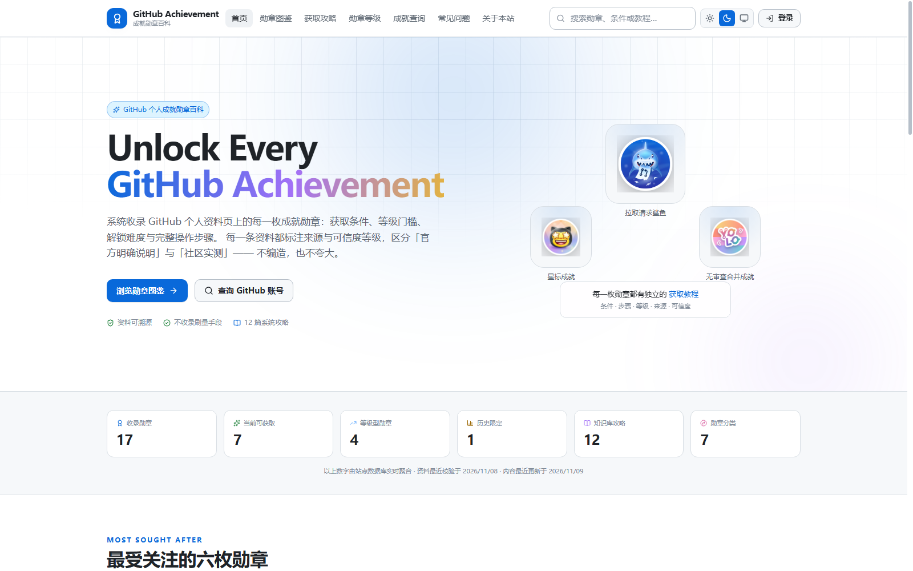
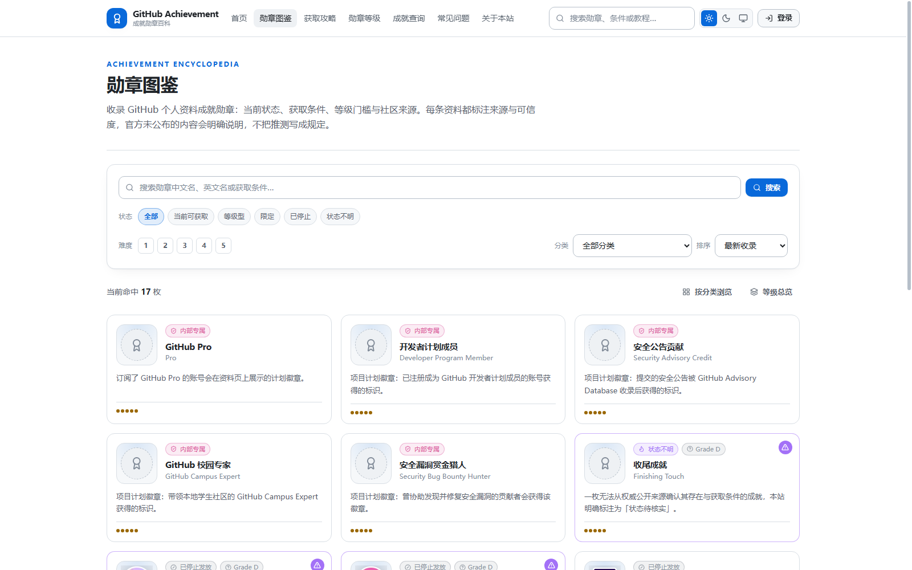
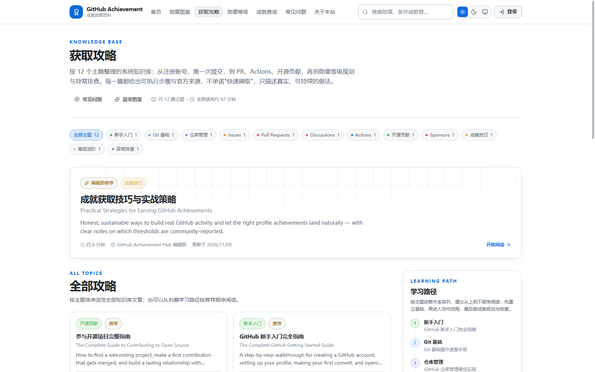
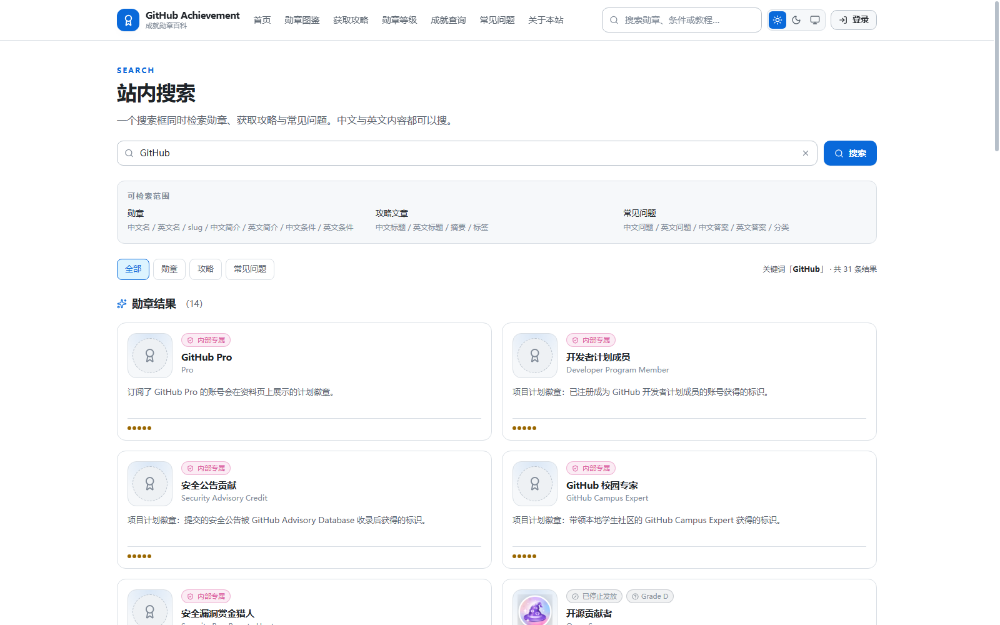
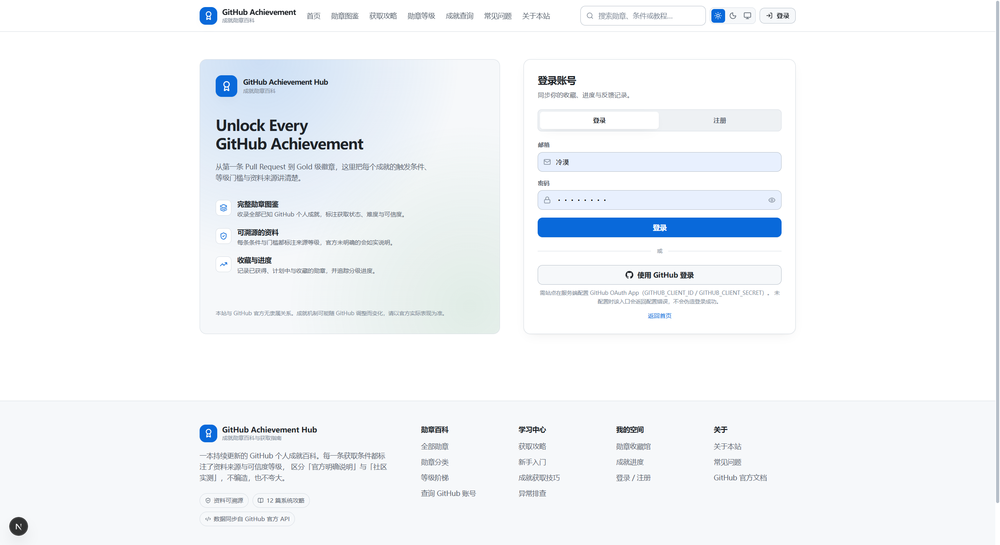
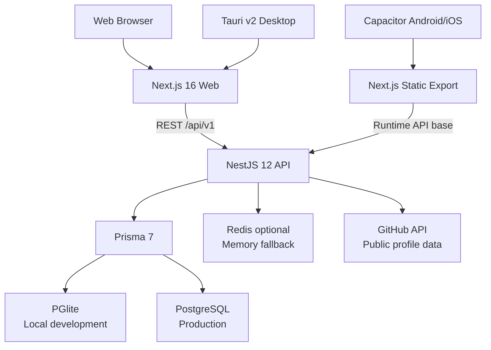

<div align="center">

# GitHub Achievement Hub

### GitHub 个人成就勋章百科与获取指南

系统收录 GitHub 个人资料页上的成就勋章，整理获取条件、等级门槛、解锁难度、操作步骤、资料来源与可信度。

<p>
  <a href="https://github.com/yuchen0x1/GitHub-Achievement-Hub/actions/workflows/release.yml"></a>
  <a href="https://github.com/yuchen0x1/GitHub-Achievement-Hub"></a>
  <a href="https://github.com/yuchen0x1/GitHub-Achievement-Hub/blob/main/package.json"></a>
</p>

<p>
  <a href="#快速开始">快速开始</a> ·
  <a href="#功能概览">功能概览</a> ·
  <a href="#运行截图">运行截图</a> ·
  <a href="#部署">部署</a> ·
  <a href="#参与贡献">参与贡献</a>
</p>

</div>

> **项目定位**：一个面向开发者、开源贡献者和 GitHub 用户的成就资料库与个人进度工具。
>
> 本站是非官方社区项目，与 GitHub, Inc. 无隶属关系。GitHub 成就机制可能发生变化，请以 GitHub 实际展示为准。

## 最新更新

### v0.0.2 · 2026-11-13

- 发布 Windows x64 安装包；桌面端支持检查更新、下载进度和签名校验后安装。
- GitHub 查询区分超时、账号不存在和限流，提供等待倒计时，并明确成就数据的可用范围。
- 修正收藏完成率，保留历史勋章；完善攻略、搜索和移动端导航的反馈。
- 新登录授权范围收窄，公开攻略仅展示已发布内容，开发环境的数据保护得到加强。

桌面端需连接自行部署的 API。安装与升级条件、各版本功能和已知限制见完整更新记录。

[查看完整更新记录](docs/releases/release-notes.md) · [下载最新版本](https://github.com/yuchen0x1/GitHub-Achievement-Hub/releases/latest)

## 目录

- [项目简介](#项目简介)
- [运行截图](#运行截图)
- [功能概览](#功能概览)
- [技术架构](#技术架构)
- [快速开始](#快速开始)
- [安装方式](#安装方式)
- [使用指南](#使用指南)
- [配置说明](#配置说明)
- [测试与质量](#测试与质量)
- [部署](#部署)
- [项目状态与已知限制](#项目状态与已知限制)
- [参与贡献](#参与贡献)
- [许可](#许可)

## 项目简介

GitHub Achievement Hub 解决的是「知道 GitHub 有成就，但不知道每枚勋章如何获得、门槛是多少、资料是否可信」的问题。

它把分散在 GitHub 官方文档、公开资料和社区实测中的信息整理成可检索的知识库，并提供个人查询、收藏和进度追踪能力：

- **查清楚**：按状态、分类、难度、热度和名称浏览成就。
- **看明白**：每枚成就拥有独立详情页，展示条件、等级、攻略、来源和可信度。
- **做得到**：通过系统攻略和等级门槛，选择适合自己的真实贡献路径。
- **记得住**：登录后收藏成就、记录进度，并导出个人数据。
- **不夸大**：官方未明确说明的门槛会标记为社区实测、待验证或较低可信度，不把推测写成规定。

当前本地种子数据包含 **17 枚勋章、16 个等级、12 篇攻略**；首页统计由 API 实时聚合，不在前端写死。

## 运行截图

以下截图来自本仓库在本地开发环境中的真实运行页面，保存于 [`docs/screenshots/`](docs/screenshots/)。截图不使用设计稿或 AI 生成界面。

### 首页 / Overview

展示项目定位、热门勋章、数据库统计、入门路径、状态分类和最新攻略。



### 勋章图鉴 / Achievement Encyclopedia

支持关键词、状态、难度、分类和排序筛选，并提供分页浏览。



### 勋章详情 / Achievement Detail

详情页集中展示获取条件、等级门槛、可信度和关联攻略。


### 攻略知识库 / Guides

按主题组织 GitHub 新手入门、Pull Request、Issues、Discussions 和成就获取策略。



### 全站搜索 / Search

搜索勋章和攻略标题、摘要及正文内容。



### 登录与注册 / Authentication

登录后可同步收藏、进度和反馈记录；GitHub OAuth 入口需要服务端配置 OAuth App。



## 功能概览

| 模块 | 已实现能力 | 状态 | 额外配置 |
| --- | --- | --- | --- |
| 勋章图鉴 | 17 枚勋章、状态/难度/分类/排序筛选、分页 | 已实现 | 无 |
| 勋章详情 | 条件、等级、可信度、来源、攻略和相关信息 | 已实现 | 无 |
| 等级系统 | Default / Bronze / Silver / Gold 门槛与进度计算 | 已实现 | 无 |
| 攻略知识库 | 12 篇攻略、分类、Markdown 正文、目录和阅读时间 | 已实现 | 无 |
| 搜索 | 全站搜索、快速搜索、建议词 | 已实现 | 无 |
| GitHub 账号查询 | 查询公开资料；明确标注成就数据不可用，支持限流等待和重试 | 已实现 | 可选服务端 GitHub Token；官方 API 不提供完整成就列表 |
| 收藏与进度 | 收藏勋章、记录进度、成就墙、数据导出 | 已实现 | 需要登录 |
| 认证 | 邮箱注册/登录、JWT、刷新令牌、CSRF 双提交校验 | 已实现 | 需要强随机密钥 |
| GitHub OAuth | OAuth 登录与账号同步入口 | 部分实现 | `GITHUB_CLIENT_ID`、`GITHUB_CLIENT_SECRET` |
| 管理后台 | 勋章、等级、要求、攻略、来源、分类、FAQ、用户、反馈和日志管理 | 已实现 | 需要管理员账号 |
| API 文档 | Swagger UI 与 Bearer Auth 描述 | 已实现 | 启动 API 后访问 `/api/v1/docs` |
| 桌面端 | Tauri v2 Windows 外壳，复用 Web 静态产物 | 已实现代码 | 需要 Rust、Tauri 和桌面构建环境 |
| 移动端 | Capacitor Android/iOS 外壳、离线缓存与网络状态监听 | 已实现代码 | 需要 Android SDK 或 macOS + Xcode |

### 关键页面

| 页面 | 路径 | 用途 |
| --- | --- | --- |
| 首页 | `/` | 项目概览、统计、热门勋章和最新攻略 |
| 勋章图鉴 | `/achievements` | 浏览、筛选和排序全部勋章 |
| 勋章等级 | `/achievements/tiers` | 查看等级型勋章的门槛阶梯 |
| 勋章分类 | `/achievements/categories` | 按获取状态和类型浏览 |
| 勋章详情 | `/achievements/:slug` | 查看单枚勋章的完整资料 |
| 攻略 | `/guides` | 浏览知识库文章 |
| GitHub 查询 | `/github-profile` | 查询公开 GitHub 账号资料 |
| 搜索 | `/search` | 全站搜索 |
| 收藏馆 | `/collection` | 管理收藏的勋章 |
| 成就进度 | `/progress` | 追踪个人进度 |
| 管理后台 | `/admin` | 管理内容和用户 |
| 登录/注册 | `/login` | 创建账号或登录 |

## 技术架构



### Monorepo 结构

```text
.
├── apps/
│   ├── api/       # NestJS REST API、Prisma schema、seed、Jest 测试
│   ├── web/       # Next.js App Router Web 应用
│   ├── desktop/   # Tauri v2 桌面端壳
│   └── mobile/    # Capacitor Android/iOS 壳与原生适配
├── packages/
│   └── shared/    # 三端共享类型、常量和工具函数
├── deploy/        # systemd 服务、Release 自动更新和回滚脚本
└── .github/
    └── workflows/ # GitHub Actions 发布工作流
```

### 技术栈

- **语言与包管理**：TypeScript、npm workspaces、Node.js。
- **Web**：Next.js 16、React 19、App Router、Tailwind CSS 4、React Query、Zustand。
- **API**：NestJS 12、Swagger、Passport/JWT、class-validator、Helmet、Throttler。
- **数据层**：Prisma 7、PGlite（本地开发）、PostgreSQL（生产）。
- **缓存**：Redis 可选；未配置时自动降级为进程内缓存。
- **桌面端**：Tauri v2。
- **移动端**：Capacitor 8，支持 Android/iOS 原生壳。
- **质量保障**：Jest、ts-jest、Supertest、TypeScript 类型检查、GitHub Actions。

## 快速开始

### 系统要求

| 项目 | 要求 |
| --- | --- |
| Node.js | 根项目要求 `>=20.11.0`；测试与 CI 使用 Node.js 24 |
| npm | 与当前 Node.js 版本兼容的 npm，仓库提供 `package-lock.json` |
| 数据库 | 本地开发默认使用内嵌 PGlite，无需单独安装 PostgreSQL 或 Docker |
| 浏览器 | 支持现代 JavaScript 的 Chromium、Firefox 或 Safari |
| 网络 | 首次安装依赖需要访问 npm registry；GitHub 查询/OAuth 需要访问 GitHub |

### 1. 安装依赖

```bash
npm ci
```

如果你需要更新 lockfile 或正在开发依赖，也可以使用：

```bash
npm install
```

### 2. 创建 API 配置

```bash
cp apps/api/.env.example apps/api/.env
```

Windows PowerShell：

```powershell
Copy-Item apps/api/.env.example apps/api/.env
```

本地开发默认配置已经使用 PGlite、自动建表和自动种子数据。请至少修改以下值：

```dotenv
JWT_SECRET=本机独有的长随机值
REFRESH_TOKEN_SECRET=本机独有的另一组长随机值
TOKEN_ENCRYPTION_KEY=64位十六进制密钥
ADMIN_PASSWORD=本机独有的管理员密码
```

不要提交 `.env`、真实密钥、OAuth secret 或签名文件。

### 3. 启动 Web 与 API

```bash
npm run dev
```

启动脚本会先构建共享包，然后并行启动：

- Web：`http://localhost:3000`
- API：`http://localhost:4000/api/v1`
- 健康检查：`http://localhost:4000/api/v1/health`
- Swagger：`http://localhost:4000/api/v1/docs`

开发环境下，API 会在数据库为空或 `DB_AUTO_SEED=true` 时同步种子资料。默认本地数据目录为 `apps/api/.pglite/`，该目录已被 Git 忽略。

### 分别启动

```bash
# 只启动 API
npm run dev:api

# 只启动 Web
npm run dev:web

# 构建后启动 API
npm run build
npm start
```

## 安装方式

当前仓库支持的安装方式如下；没有把 Docker、npm registry 包、Homebrew、Scoop 或预构建安装包写成已支持渠道。

| 方式 | 适合用户 | 依赖 | 推荐度 |
| --- | --- | --- | --- |
| 本地源码 + PGlite | 开发者、评估者 | Node.js、npm | 推荐 |
| Linux systemd 部署 | 自托管生产环境 | Node.js 24、PostgreSQL、systemd | 推荐 |
| Tauri 桌面构建 | Windows 桌面用户/开发者 | Rust、Tauri CLI、Web 构建环境 | 实验性 |
| Capacitor 移动构建 | Android/iOS 开发者 | Android SDK 或 macOS + Xcode | 实验性 |
| Docker | - | 当前仓库没有 Dockerfile/Compose | 不支持 |

### 生产构建

```bash
npm ci
npm run build

# API 生产进程
npm start

# Web 生产进程（另开终端）
npm run start -w @gach/web
```

生产环境请设置 `DB_PROVIDER=postgres` 和 `DATABASE_URL`，并关闭 `DB_AUTO_PUSH`、`DB_AUTO_SEED`。生产部署的 systemd、Release 轮询、健康检查、自动回滚和数据库注意事项见 [`deploy/README.md`](deploy/README.md)。桌面端 Tauri 更新、签名清单、GitHub Secrets 和发布验收见 [`docs/AUTO_UPDATE.md`](docs/AUTO_UPDATE.md)。

### 桌面端

桌面端使用 Tauri v2，开发服务器复用 `http://localhost:3000`：

```bash
npm run desktop:dev
```

构建桌面安装包：

```bash
npm run desktop:build
```

具体 Rust/Tauri 环境要求以 Tauri 官方工具链和 [`apps/desktop/`](apps/desktop/) 当前配置为准。

### 移动端

移动端通过 Next.js 静态导出生成 Web 资源，再由 Capacitor 注入运行时 API 地址和原生适配脚本：

```bash
# 同步 Web 产物到 apps/mobile/www
npm run mobile:sync

# 打开 Android Studio / Xcode 工程
npm run mobile:android
npm run mobile:ios
```

Android Debug APK 的完整环境要求、平台添加、同步、构建和签名流程见 [`apps/mobile/README.md`](apps/mobile/README.md)。iOS 构建需要 macOS 和 Xcode。

### AI 辅助安装提示词

本项目没有伪装成“一键安装器”的 AI 命令。你可以把下面的提示词复制到 Claude Code、Cursor、Codex、GitHub Copilot、Cline 或其他开发代理中，让它严格按仓库文档执行：

```text
请在当前目录分析并运行 GitHub Achievement Hub：
1. 先检查 Node.js 版本（根项目要求 >=20.11.0，测试使用 Node 24）。
2. 阅读 package.json、apps/api/.env.example、README.md 和 deploy/README.md。
3. 执行 npm ci，不要删除用户文件，也不要读取或输出任何密钥。
4. 从 apps/api/.env.example 创建本地 apps/api/.env，并要求我在真实密钥字段中自行填写值。
5. 使用本地 PGlite 配置运行 npm run dev。
6. 验证 http://localhost:3000、http://localhost:4000/api/v1/health 和 Swagger 页面。
7. 如果失败，说明真实错误原因，不要伪造成功结果或绕过认证与安全检查。
```

## 使用指南

### 浏览和筛选勋章

1. 打开 `/achievements`。
2. 使用关键词搜索勋章名称或英文名称。
3. 按“当前可获取、等级型、限定、已停止、状态不明”筛选。
4. 按难度、分类或排序方式缩小结果。
5. 点击卡片进入 `/achievements/:slug`，查看条件、等级和来源。

### 查看等级门槛

打开 `/achievements/tiers` 查看等级型勋章的 Default、Bronze、Silver 和 Gold 阶梯。门槛属于资料库字段；GitHub 未公开确认的数字会标注可信度和不确定性。

### 阅读攻略

打开 `/guides`，按“新手入门、Git 基础、仓库管理、Issues、Pull Requests、Discussions”等主题浏览文章。文章详情页支持 Markdown 正文、目录和阅读时间。

### 查询 GitHub 账号

打开 `/github-profile`，输入公开 GitHub 用户名。该功能只读取公开资料，不读取私有仓库内容；GitHub API 限制、网络状态和账号公开信息会影响结果。

### 登录、收藏和进度

1. 在 `/login` 注册或登录。
2. 在勋章详情页收藏目标勋章。
3. 在 `/collection` 管理收藏与成就墙。
4. 在 `/progress` 记录已完成的条件和当前数量。
5. 使用 API 提供的导出入口导出个人数据。

GitHub OAuth 需要在服务端配置 OAuth App，并将回调地址设置为：

```text
http://localhost:4000/api/v1/auth/github/callback
```

### 管理后台

管理员登录后可访问 `/admin`，管理勋章、等级、要求、攻略、来源、分类、FAQ、用户、反馈、公告和操作日志。管理员初始账号由 seed 配置创建，生产环境必须替换默认值。

## 配置说明

完整模板见 [`apps/api/.env.example`](apps/api/.env.example)。常用配置如下：

| 参数 | 说明 | 必填 | 默认/示例 |
| --- | --- | --- | --- |
| `NODE_ENV` | 运行环境 | 否 | `development` |
| `PORT` | API 监听端口 | 否 | `4000` |
| `API_PREFIX` | API 全局前缀 | 否 | `/api/v1` |
| `WEB_ORIGIN` | CORS 允许的 Web 来源 | 否 | `http://localhost:3000` |
| `DB_PROVIDER` | `pglite` 或 `postgres` | 否 | `pglite` |
| `DATABASE_URL` | PostgreSQL 连接串 | 生产必填 | 由部署环境提供 |
| `PGLITE_DATA_DIR` | 本地 PGlite 数据目录 | 否 | `./.pglite` |
| `PGLITE_PORT` | PGlite 本地端口 | 否 | `55432` |
| `PGLITE_REUSE_EXTERNAL` | 明确允许复用端口上已存在的本项目 PGlite 实例；默认拒绝 | 否 | `false` |
| `DB_AUTO_PUSH` | 开发时自动同步 Prisma schema | 否 | `true`（开发示例） |
| `DB_AUTO_SEED` | 开发时自动同步种子资料 | 否 | `true`（开发示例） |
| `REDIS_URL` | Redis 连接串 | 否 | 留空时使用进程内缓存 |
| `JWT_SECRET` | JWT 签名密钥 | 是 | 必须使用随机值 |
| `REFRESH_TOKEN_SECRET` | 刷新令牌密钥 | 是 | 必须使用独立随机值 |
| `TOKEN_ENCRYPTION_KEY` | GitHub token 加密密钥 | 需要 GitHub 同步时 | 64 位十六进制值 |
| `GITHUB_CLIENT_ID` | GitHub OAuth Client ID | OAuth 必填 | 留空则禁用 OAuth |
| `GITHUB_CLIENT_SECRET` | GitHub OAuth secret | OAuth 必填 | 留空则禁用 OAuth |
| `GITHUB_TOKEN` | 服务端 GitHub API token | 否 | 留空也可运行 |

### 数据库模式

- **本地开发**：`DB_PROVIDER=pglite`，API 进程启动内嵌 PostgreSQL 兼容实例，无需 Docker 或单独 PostgreSQL。
- **生产环境**：`DB_PROVIDER=postgres`，使用标准 PostgreSQL 的 `DATABASE_URL`。
- **Redis**：仅在设置 `REDIS_URL` 且连接成功时启用；否则自动使用进程内缓存。

### 数据初始化

```bash
# 推送当前 Prisma schema（适合本地开发）
npm run db:push

# 幂等写入勋章、攻略、FAQ 和管理员种子数据
npm run seed

# 打开 Prisma Studio
npm run db:studio
```

生产部署不要用 `prisma db push` 代替受控 migration。当前仓库没有 `apps/api/prisma/migrations/` 基线，详见 [`deploy/README.md`](deploy/README.md) 的数据库迁移章节。

## API 与开发者入口

启动 API 后可使用：

- Swagger UI：`http://localhost:4000/api/v1/docs`
- 健康检查：`GET /api/v1/health`
- 勋章：`/api/v1/achievements`
- 攻略：`/api/v1/articles`
- 搜索：`/api/v1/search`
- 认证：`/api/v1/auth`
- 收藏与成就墙：`/api/v1/collection`
- 进度：`/api/v1/progress`
- GitHub 查询：`/api/v1/github`
- 管理后台：`/api/v1/admin`

Swagger 文档是 API 参数和认证方式的权威入口，不在 README 中复制整套请求/响应定义。

## 测试与质量

```bash
# API 单元测试
npm run test:unit -w @gach/api

# API e2e 测试（使用独立 PGlite 测试库）
npm run test:e2e -w @gach/api

# 全量 API 测试
npm run test:api

# 类型检查
npm run lint

# 构建 shared + API + Web
npm run build
```

测试环境使用专用 `PGLITE_PORT=55499` 与每次运行唯一的 `.pglite-test-*` 数据目录。若测试端口已被占用，API 会拒绝复用已有服务，避免误连其他项目的数据库。单元测试覆盖 CSRF 服务、文本工具和等级进度计算；e2e 覆盖健康检查、勋章、攻略、FAQ、搜索、鉴权、越权和敏感字段不泄露等路径。

## 部署

仓库提供面向 Linux/systemd 的 Release 自动更新方案：

- 只处理正式 `vX.Y.Z` GitHub Release。
- 独立版本目录构建，健康检查通过后原子切换 `current`。
- API 健康检查通过后才重启 Web。
- 新版本构建或健康检查失败时自动恢复上一版本。
- 默认不执行数据库 migration，生产数据库必须先准备好受控 schema。

部署入口：[`deploy/README.md`](deploy/README.md)。

### 发布流程

推送符合 SemVer 的标签后，GitHub Actions 会执行依赖安装、lint、API 单元测试、生产构建，并在签名 Secrets 齐备时创建包含桌面安装包与更新清单的 draft GitHub Release：

```bash
git tag v1.1.0
git push origin v1.1.0
```

发布工作流位于 [`.github/workflows/release.yml`](.github/workflows/release.yml)。确认 draft Release 的安装包、`.sig` 和 `latest.json` 完整后，需要在 GitHub 上手动发布它，桌面客户端才会把它作为稳定更新；缺少签名 Secrets 时工作流不会创建空 Release。仓库当前没有 Docker 镜像发布流程，也没有已提交的预构建移动安装包。

## 项目状态与已知限制

### 已完成

- Web、API、共享包的本地开发链路。
- 勋章百科、攻略、搜索、账号查询、收藏与进度功能。
- JWT 认证、管理员后台、Swagger API 文档。
- PGlite 本地开发数据库、幂等 seed、Redis 可选缓存。
- Tauri/Capacitor 原生壳代码和 Linux systemd 发布脚本。
- Release tag 驱动的 CI 校验与自动发布。

### 需要额外环境或配置

- GitHub OAuth 登录需要 OAuth App 的真实配置。
- GitHub 账号同步需要 GitHub API 可访问；服务端 token 可选。
- Tauri 构建需要 Rust 与平台工具链。
- Android 构建需要 Android SDK；iOS 构建需要 macOS 和 Xcode。
- 生产部署需要 PostgreSQL、systemd 和受控数据库初始化流程。

### 已知问题与注意事项

- API e2e 已验证 `POST /auth/login` 在存在 CSRF cookie 且缺少 header 时返回 401；认证与敏感字段回归覆盖见 [`apps/api/README.md`](apps/api/README.md)。
- 移动端静态导出：`@gach/web export:static` 会在跨平台脚本中执行 `NEXT_OUTPUT=export next build` 并校验真实 `out/index.html`；动态详情页需要构建时可达且已初始化的 API，详见 [`apps/mobile/README.md`](apps/mobile/README.md)。
- 当前仓库没有 Prisma migration 基线，因此生产自动更新默认不会执行 migration。
- 根 `package.json` 的 license metadata 为 MIT，但仓库当前没有独立 `LICENSE` 文件；正式对外分发前应补齐许可证文件。

## 参与贡献

欢迎提交内容校正、资料来源、功能改进和测试补充。

```bash
# Fork 后克隆
 git clone https://github.com/yuchen0x1/GitHub-Achievement-Hub.git
 cd GitHub-Achievement-Hub
 npm ci

# 创建功能分支
git switch -c feat/your-change

# 修改后验证
npm run lint
npm run test:unit -w @gach/api
npm run build

# 提交并推送
git add .
git commit -m "feat: describe your change"
git push -u origin feat/your-change
```

提交 Pull Request 时请说明：

1. 修改解决的问题和影响范围。
2. 是否涉及数据库 schema、环境变量或 API 行为。
3. 使用了哪些测试命令，以及测试结果。
4. 如果修改 UI，请附上真实运行截图或录屏。
5. 不要提交 `.env`、私钥及其密码、数据库目录、构建缓存、`node_modules` 或本地安装包。安装包及其公开校验签名通过 GitHub Releases 分发。

### 本地文件与仓库边界

- `.evolution/`、`_research/` 和根目录旧审计报告属于临时研究材料，不进入源码仓库；有长期价值的结论整理到 `docs/`。
- `.next/`、`out/`、`dist/`、Rust `target/`、Gradle 构建缓存及 `.tsbuildinfo` 可在停止相关进程后清理，之后需重新构建。移动端生成的资源通过 `npm run mobile:sync` 恢复。
- `.env`、`apps/api/.pglite/`、桌面端 `.tauri/` 中的签名密钥与密码是本地配置或数据；忽略提交不代表可以删除。`.pglite-*` 也默认忽略，仅在确认是已停用的临时数据库后清理。
- `.release/` 保留本地发布副本，不提交 Git；发布附件以对应 GitHub Release 为准。
- 保留源码、锁文件、环境配置示例、Gradle Wrapper、应用图标和文档截图。`apps/api/src/generated/prisma/` 当前被构建直接引用，不能按普通缓存删除。

## 许可

根 `package.json` 声明项目使用 **MIT** 许可。由于仓库当前没有独立 `LICENSE` 文件，正式发布或再分发前请先补齐许可证文本。

## 致谢与资料边界

- GitHub 官方公开文档和 GitHub API。
- 开源社区对成就触发条件和等级门槛的公开实测。
- 本项目的资料会区分官方明确说明、社区实测和待验证信息。

---

<div align="center">

**Build real contributions. Let the achievements follow.**

</div>
